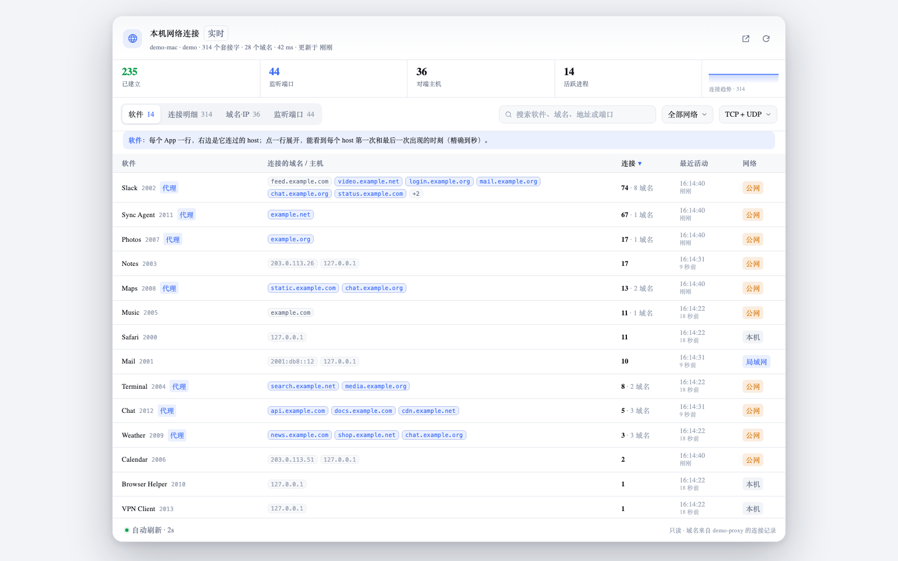
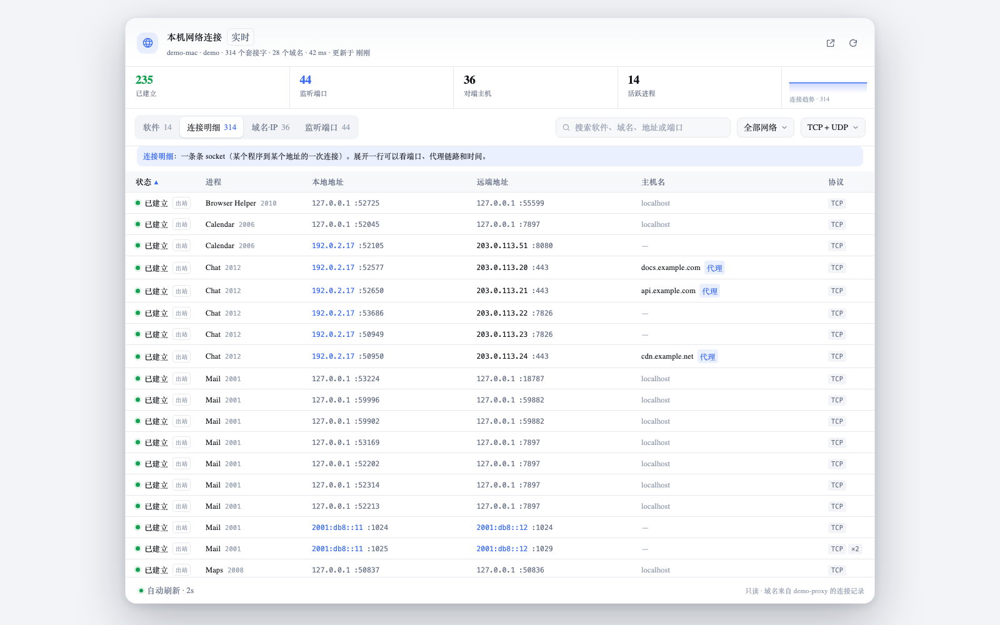
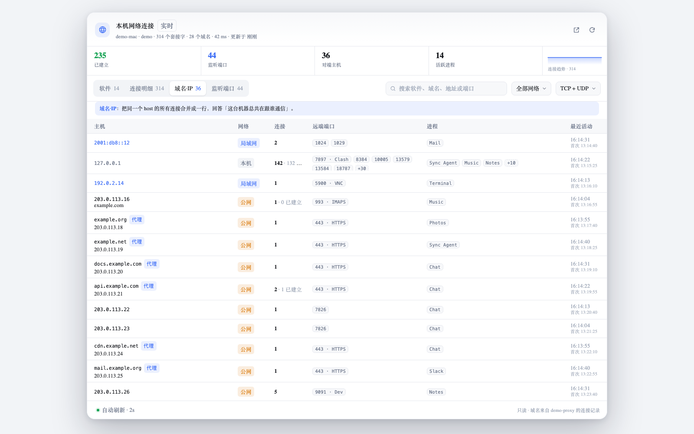

# dsh-net-hosts

查看本机网络连接与对端主机的 DSH 插件。

它把 `lsof -i` 的套接字表整理成两件事：一个随时可以点开的**实时面板**，和一个给 Agent 用的 **`net_connections` 工具**。整个插件只读——不建立连接、不修改配置、不发任何数据到外部。

面板在 DSH 左侧栏里（「上下文洞察」下面的一项「**网络连接**」），点进去就是一个完整主页面，默认打开「软件」视图，直接回答「**这台机器上哪个软件，在连哪些域名**」：



## 能做什么

- **软件**（默认）：每个进程一行，列出它正在连接的域名（经本地代理的连接会还原出真实域名，单独高亮）；连接数、域名数、**最近活动（精确到秒）**、所在网络一目了然。点一行原地展开，能看到它连过的每个 host 第一次、最后一次出现的时刻，以及一条「查看全部连接」的入口。
- **连接明细**：每条 TCP/UDP 套接字一行，显示状态、进程/PID、本地 → 远端地址、主机名；经本地代理的连接会显示真实目标 IP:端口与域名，并带「代理」徽标。循环连接按 `pid + 四元组` 去重，重复的 fd 合并成 `fds`。展开一行可以看端口、代理规则/链路和该主机的首次/最近时间。
- **域名·IP**：按对端聚合——连接数、已建立数、远端端口、涉及进程、首次/最近出现时间；经代理的连接按**域名**聚合，IP 收在副标题里。这是回答「这台机器总共在跟谁通信」最快的入口。
- **监听端口**：只列 LISTEN 状态的端口，方便排查谁占了端口。
- 每个视图上方都有一句话解释它和别的视图的区别，不用记概念。
- 搜索（软件、域名、地址、端口）、按网络范围筛选（公网 / 局域网 / 本机）、按 TCP/UDP 筛选、点表头排序、展开行看完整信息、一键复制地址。
- 2 秒自动刷新；页面隐藏时自动暂停；也可以手动暂停/刷新。
- 侧边栏入口是主路径；悬浮胶囊只在没有侧边栏入口时出现（也可用 `⌘⇧N` 直接打开）。胶囊可以**拖动**到任意位置（位置记在 `localStorage`）；胶囊右上角一直有一个 ×，点它隐藏入口，或者点开面板后用底部的「隐藏入口」。隐藏后左下角会弹出一个 20 秒的「网络入口已隐藏 · 恢复」提示，点恢复即可；随时按 `⌘⇧N`（Windows/Linux 为 `Ctrl+Shift+N`）也能直接打开面板并恢复入口。隐藏不会持久化，刷新页面入口仍在原位置。
- 亮色/暗色跟随系统；界面用 Shadow DOM 隔离，不会和 DSH 的样式互相污染。

| 连接视图 | 主机视图 |
| --- | --- |
|  |  |

暗色主题：[docs/panel-dark.png](docs/panel-dark.png)。

## 安装

需要 DSH `>= 0.2.0`，macOS（依赖系统自带的 `lsof`）。

**本地开发安装（link）：**

```bash
dsh plugin --profile web add link:~/dsh-plugins/dsh-net-hosts
```

**在 desktop profile 里手动启用：** 把包加入 `~/.dsh/profiles/desktop/package.json` 的 `dependencies`，并把 `dsh-net-hosts` 追加到 `dsh.profile.bundles` 末尾，然后在 profile 的 `node_modules` 里放一个指向本目录的软链接。重启 DSH 后生效。

安装后界面左下角会出现「网络」胶囊按钮（徽标显示当前已建立连接数），点击即可打开面板；也可以直接访问 `http://127.0.0.1:<dsh 端口>/net-hosts/` 使用独立页面。

## 模型工具

插件会把同一份数据注册成 `net_connections` 工具，Agent 可以直接调用：

| 参数 | 类型 | 说明 |
| --- | --- | --- |
| `state` | string | `all`（默认）/ `established` / `listening` |
| `scope` | string | `all`（默认）/ `public` / `lan` / `loopback`，按远端地址归类 |
| `limit` | number | 最多返回多少条，默认 40，上限 200 |

返回一段文本表（摘要 + 逐行 `状态 进程(PID) 协议 本地 -> 远端 主机名`）。工具定义是手写的（只依赖 `tools.register` 的公开契约），不依赖 `@deepseek-ai/dsh-tools` 的裸包名解析，所以装在任意目录都能注册；万一注册失败只写 debug 日志，面板不受影响。

## HTTP 接口

所有接口都是同源只读 GET：

| 路径 | 说明 |
| --- | --- |
| `/net-hosts/` | 独立页面（Shadow DOM 渲染） |
| `/net-hosts/ui.js` | 面板脚本 |
| `/net-hosts/launcher.js` | 悬浮入口脚本（宿主注入） |
| `/net-hosts/api/snapshot` | 快照 JSON；`?fresh=1` 跳过 700ms 复用窗口 |
| `/net-hosts/api/health` | `{ ok, name, version }` |

鉴权由插件自己做：Host 必须是回环地址（或 `DSH_NET_HOSTS_TRUSTED_HOSTS` / `DSHW_TRUSTED_HOSTS` 里列出的主机）、拒绝 `Sec-Fetch-Site: cross-site`、Origin 必须与 Host 一致，异常一律按拒绝处理（fail-closed）；存在 `connection` 服务时再叠加它的 `requestRejection`。403 时不返回任何内容。

## 域名从哪来（本地代理）

开着系统代理时，应用连的是 `127.0.0.1:7897`，`lsof` 只能看到这层壳；真实域名（SNI / HTTP Host）只存在于代理进程里。插件读本地 Clash 系内核的 HTTP 控制接口，用 `metadata.sourcePort` 和 `lsof` 的本地端口配对，把「应用 → 127.0.0.1:7897」还原成「应用 → www.xueqiu.com:443」。

自动发现顺序：

1. 环境变量 `DSH_NET_HOSTS_PROXY_URL`（`host:port` / `http://…` / `unix:///…`）、`DSH_NET_HOSTS_PROXY_SOCKET`；
2. Clash Verge Rev / ClashX / mihomo 的配置文件（`external-controller`、`external-controller-unix`、`mixed-port` 等）；
3. Clash Verge Rev 服务模式的特权助手 socket：`/var/run/clash-verge-service/users/<uid>/verge-mihomo.sock`；
4. 常见控制器端口 `9097 / 9090 / 9091 / 6170`。

需要 `secret` 时读配置文件，或设 `DSH_NET_HOSTS_PROXY_SECRET`。发现结果成功缓存 60 秒、失败 8 秒；控制接口不可达是常态，所有失败都静默降级，不影响 lsof 主流程。

命中代理的连接：远端地址显示真实目标 IP:端口，主机名显示域名 +「代理」徽标；展开行可以看到命中的规则、链路和代理入口（`127.0.0.1:7897`）。主机视图按域名聚合，同一域名解析出的多个 IP 收在副标题里；没有域名时仍按 PTR 兜底。`/net-hosts/api/snapshot` 里的 `proxy` 字段会告诉你用的是哪个端点、拿到多少条代理连接。

## 数据从哪来

1. 执行 `lsof -nP -i -F pcnPT`（5 秒超时），解析 `p/c/f/P/n/T` 字段。
2. 过滤掉 ICMP/ICMPv6 等无端口协议，只保留 TCP/UDP；还原 lsof 对非 ASCII 进程名做的 `\xNN` 转义。
3. 反向 DNS 解析对端地址：成功缓存 30 分钟、失败缓存 10 分钟，最多 6 个并发、单次 900ms 超时，**不阻塞快照**——第一次没解析出来就先显示地址，下一轮轮询补上主机名。
4. 时间：数据层维护一份 host 观察表，记录每个 host 第一次和最后一次出现的时刻（毫秒）；界面显示到秒，「软件」视图里展开一行就是一张 host × 时间的小表。这份时间从插件进程启动算起，重启 DSH 会重新计时。
5. 若发现本地代理控制接口，拉 `GET /connections` 并按 `sourcePort` 合并域名（见上一节）；快照不等待它，第一次没拿到就先显示 IP，下一轮补上。
6. 快照复用窗口 700ms，避免多个视图同时刷新时重复 fork `lsof`。

## 开发

```bash
cd dsh-net-hosts
node --test test/collect.test.js test/proxy.test.js test/plugin.test.js
```

- `lib/collect.js`：lsof 解析、地址分类、反向 DNS 缓存、快照组装、代理连接合并（纯数据层，可单独测试）。
- `lib/proxy.js`：本地代理（Clash / mihomo）控制接口发现、`/connections` 归一化；配置、unix socket、常见端口三种发现方式，失败静默。
- `lib/ui.js`：零依赖的 Shadow DOM 界面（软件 / 连接 / 主机 / 监听 四个视图，其中「软件」在客户端按进程聚合），暴露 `window.__DSH_NET_HOSTS_UI__.mount(target, { standalone })` 与 `.mountLauncher(host)`。
- `lib/index.js`：宿主插件，注册路由、注入入口、注册模型工具。
- `lib/launcher.js`：页面内的悬浮入口，由宿主通过 `tapIndex`（HTTP 版）或 `webserver/index-inject`（桌面版）注入。

## 上架 dsh-market

dsh-market 的列表来自 [awesome-dsh-plugin](https://github.com/awesome-dsh-plugin/awesome-dsh-plugin)：发布到 npm、再给列表提一条 `data/plugins/<owner>__dsh-net-hosts.yml`，市场里就能搜到并一键安装/更新。完整步骤见 [PUBLISH.md](PUBLISH.md)，条目模板见 [market-entry.yml](market-entry.yml)。

## 限制

- 非 root 运行，只能看到当前用户的进程；其他用户的连接不可见（界面底部会标注）。
- `lsof` 是 fork 外部进程，刷新间隔 2 秒已经足够；不建议把间隔调到 1 秒以下。
- 反向 DNS 依赖本机 DNS 配置，没有 PTR 记录的地址会显示 `—`。
- 域名依赖本地代理（Clash / mihomo）的控制接口；没开代理、控制接口不可达，或使用的是其他代理软件时，只能看到 IP。
- 域名只覆盖「应用 → 本地代理」这一段能对上的连接；代理自身的出站连接、直连流量仍按 IP 展示。
